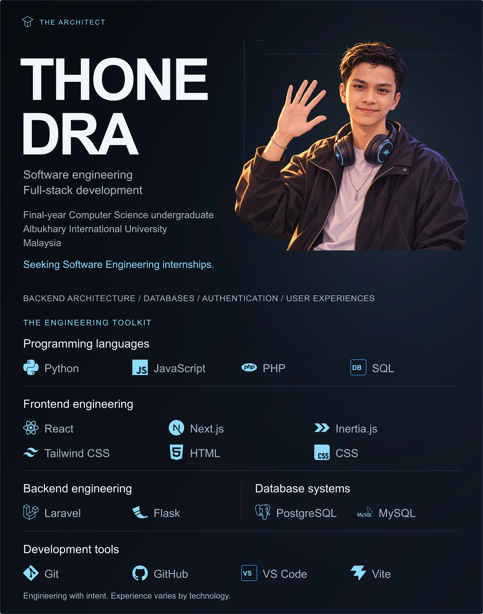
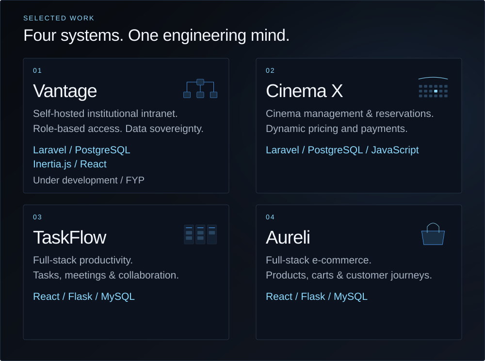
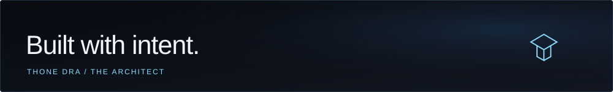

  <picture>
    <source media="(max-width: 760px)" srcset="assets/hero-mobile.png 2x">
    
  </picture>

  <picture>
    <source media="(max-width: 760px)" srcset="assets/selected-work-mobile.svg">
    
  </picture>

Accessible text version

### Thone Dra

**Software Engineering · Full-Stack Development.** Final-year Bachelor of Computer Science undergraduate at **Albukhary International University, Malaysia**. Seeking **Software Engineering internships**.

Engineering interests: backend architecture, databases, authentication, full-stack applications, and thoughtful user experiences. Experience varies by technology.

- **Programming languages:** Python · JavaScript · PHP · SQL
- **Frontend engineering:** React · Next.js · Inertia.js · Tailwind CSS · HTML · CSS
- **Backend engineering:** Laravel · Flask
- **Database systems:** PostgreSQL · MySQL
- **Development tools:** Git · GitHub · VS Code · Vite

### Selected work

- **Vantage:** Self-hosted institutional intranet with role-based access and data sovereignty. Laravel · PostgreSQL · Inertia.js · React. **Final Year Project · Under development.**
- **Cinema X:** Cinema management, reservations, dynamic pricing, and payments. Laravel · PostgreSQL · JavaScript.
- **TaskFlow:** Full-stack productivity and collaboration, including tasks and meetings. React · Flask · MySQL.
- **Aureli:** Full-stack e-commerce with products, carts, and customer experiences. React · Flask · MySQL.

## GitHub activity

A GitHub-generated metrics snapshot, including an isometric contribution calendar and activity statistics.

  

[Full-size dashboard →](github-metrics.svg) · [Current activity →](https://github.com/thonedra-dev)

## Connect

**Let's build something considered.** Internships, collaboration, and technical conversations.

[LinkedIn ↗](https://www.linkedin.com/in/thone-dra-86048542a/) · [GitHub ↗](https://github.com/thonedra-dev)

**+60 11 2892 2047** · [Message on WhatsApp ↗](https://wa.me/601128922047)

